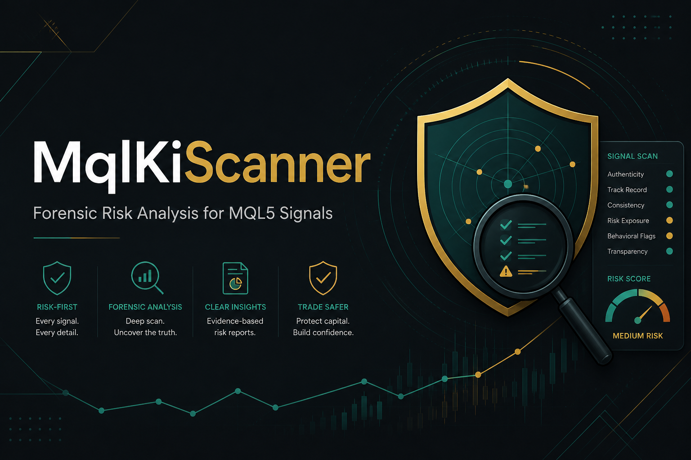

<p align="center">
  
</p>

# SignalKiScanner (MqlKiScanner Hub)

**Zentraler Multi-Source-Hub & forensischer Scanner für Trading-Signale (MQL5, Pelican, RoboForex, Vantage, ZuluTrade).**  
Python 3.12 · Streamlit · Forensik im Code · optionale GLM-KI-Berichte.

> **Risiko vor Ertrag.** Harte Drawdown-Schranke (Standard 30 %), Jahres-Calmar mindestens `min_calmar_jahr` (Default 3,0) auf gemessenem Equity-DD und mindestens drei Monate Trade-Historie. Die absolute Monats-Ertragshürde ist standardmäßig aus; fehlender Stop-Nachweis ist neutral.

Dokumentationsabgleich: 16.10.2026. **MqlRealmonitor ist noch nicht in den
Gesamtworkflow eingebunden.** REST-Server und Client-Code sind vorbereitet;
die Integration bleibt vorerst zurückgestellt. **PelicanWinnerLooser ist ein
eigenständiges Einzelprojekt und ebenfalls noch nicht in den Gesamtworkflow
eingebunden**; eine Hub-Anbindung ist nicht implementiert.

Die Korrekturen des [Gesamtreviews vom 16.10.2026](doc/reviews/2026-10-16_gesamtreview/BEHEBUNG.md)
verwenden Forensik-Version 17. Ältere Befunde und Equity-Studien werden nicht
als aktuelle Freigabe wiederverwendet. Vor einer neuen Auswahl müssen die
geänderten Quellen neu gebaut und gestartet sowie betroffene Signale neu
geladen und analysiert werden. Kapitalflüsse während offener Positionen
erlauben ohne belegte Equity am Flusszeitpunkt keinen belastbaren Calmar.

[](https://www.python.org/downloads/)
[](https://streamlit.io/)
[](#lizenz--hinweis)

---

## Warum dieses Tool?

Signalnamen und Abonnentenzahlen belegen keine geringe Verlustgefahr. Der
SignalKiScanner holt Rohdaten über Quellen-REST oder direkt von MQL5 ab und
berechnet Exposure, Martingale-Signaturen, Drawdowns und Stop-Evidenz im Code.
Optionale LLM-Berichte interpretieren diese Befunde. Die manuelle
Tiefenanalyse darf ergänzende Rechnungen mit offengelegten Annahmen erstellen;
Ampel und Score werden dadurch nicht geändert.

## Features

- **Multi-Source-Hub:** Bindet MQL5, Pelican Trading, RoboForex CopyFX, Vantage Copy und ZuluTrade über das standardisierte Protokoll `mql5-downloader-v1` an.
- **Stufe 0 – Clients aktualisieren:** Aktualisiert aktive Quellen parallel über `POST /api/v1/update` und wartet per Statusabfrage vor dem Scan auf deren Abschluss; für GUI und autonome Scans konfigurierbar.
- **SHA-256 Delta-Ingest:** Erkennt unveränderte Trades und Metrics im Quellen-Cache. Der Teilscan erzwingt weiterhin neue KI-Berichte; der SHA-Vergleich ist keine generelle Zusage, Modellaufrufe zu überspringen.
- **TrueRetDD / Jahres-Calmar:** `cagr_jahr_pct ÷ gemessener Max-Equity-DD`; Monats-RetDD und geometrische Monatsrendite bleiben zusätzliche Kennzahlen. Die 9. Matrix-Zelle prüft den konfigurierten Jahres-Calmar. Monitor-Closing-DD und Plattformangaben ersetzen keine H1-Equity-Messung als Nenner; orange Vorbehaltswerte sind kein Grün-Beleg.
- **Kopier-Simulation in der KI-Studie:** Interaktive Simulation mit konstantem 10.000-USD-Modellkonto („Was wäre mit deinem Konto passiert?“).
- **Kapitalfluss-Brücke:** Berücksichtigt überlieferte Einlagen und Entnahmen und macht die Kapital- und Zeitbasis der Kennzahlen sichtbar.
- **Deterministische Forensik-Batterie:**
  - Martingale- & Lot-Größen-Explosionserkennung
  - Peak-Exposure (Anzahl- und Schock-Peak)
  - Stop-Loss-Evidenz (Orderbuch-Prüfung vs. statistisches Verlustbegrenzungsverhalten)
  - Rekonstruierter Equity-Drawdown auf H1-Bar-Schlusskursen mit Auto-GMT-Zeitsynchronisation; Intrabar-Tiefs sind damit nicht vollständig erfasst
  - Harte 30-%-Drawdown-Schranke
- **Optionale KI-Berichte:** Trade- und Risiko-Analyse parallel, anschließend Gesamtbericht; Modelle konfigurierbar (Defaults GLM-5.3 / GLM-5.3-Flash). Zusätzlich autonomer Agentenbetrieb für Beobachtung, Dossiers und Meldungen.
- **Append-only Wechsel-Protokoll:** Lückenlose Historisierung jedes Ampelwechsels (alt → neu je Kriterium) zur revisionssicheren Nachvollziehbarkeit.
- **Zwei Scan-Modi:** **Full-Scan** (ausgewählte Kandidaten) und **Teilscan** (aktuell grüne/gelbe Signale plus Fix-IDs; alle KI-Stufen neu).
- **Tradeserver-Sync v1:** Transaktionale Synchronisation von Signaldaten und PDF-Dossiers zum `MqlTradeMonitor` (:8080).
- **Vorbereitete REST-API für MqlRealmonitor:** Schreibgeschützt unter `127.0.0.1:8611/api/v1` (`/health`, `/signals?ampel=gruen,gelb`). Die vorhandene Schnittstelle bedeutet keine abgeschlossene Integration; diese bleibt zurückgestellt.

## Schnellstart

```bash
git clone https://github.com/tnickel/MqlKiScanner.git
cd MqlKiScanner
python -m venv .venv
# Windows: .venv\Scripts\activate
pip install -r requirements.txt
copy .env.example .env   # Keys eintragen — oder später in der Admin-UI
streamlit run streamlit_app.py
```

Unter Windows: Doppelklick auf `start.bat` → http://localhost:8504

Verbindungsanzeigen werden parallel im Hintergrund geprüft, ohne den
Seitenaufbau abzuwarten. Während einer erneuten Prüfung bleibt das letzte
Ergebnis sichtbar; die Anzeigen aktualisieren sich alle zwei Sekunden.
Netzprüfungen sind fünf Minuten gecacht.

„Alle Signale“ lädt Katalog-Artefakte gesammelt und erzeugt beim Öffnen keine
PDFs. Die Ladeanzeige nennt Phase, erledigte Signale, vergangene Zeit und die
geschätzte Restzeit der jeweiligen Phase. Bei einzelnen SQL-Abfragen ist die
Restzeit zunächst unbekannt. PDF-Speicherung prüft Inhalt und Renderer-Version
über Cache-Metadaten; unveränderte, intakte PDFs werden wiederverwendet.
Ältere PDFs ohne diese Metadaten werden beim nächsten PDF-Zugriff einmalig
verifiziert und anschließend ebenfalls wiederverwendet.

Die Übersicht übernimmt eine virtuelle 10.000-USD-Kapitalbasis nur aus einer
Studie mit passender Trade-SHA. „Messstatus“ kennzeichnet diese Annahme und
zeigt Gründe für unvollständige Messungen; deren Werte sind orange markiert.
„Nur Lücken füllen“ versucht unzuverlässige Rohmessungen erneut. Das bloße
Vorhandensein eines Roh-DD gilt dabei nicht als abgeschlossene Messung.

Alle Kursdatenquellen (Tickmill, ActivTrades und Vantage) starten ausdrücklich
mit `/portable` im jeweiligen Terminalverzeichnis und prüfen danach
Datenverzeichnis und Broker-Verbindung.
Die belegten Devisenpaare und Gold tragen dort `+`; Index-Futures verwenden
das kleingeschriebene `ft`. Aktien, Krypto und Cash-Indizes erhalten kein
pauschales Suffix. Nachweise und die Prüfung von 96 Tabellenzellen stehen in
`doc/reviews/vantage_zellen_2026-10-10.md` und den zugehörigen JSON-Dateien.
ActivTrades verwendet unter anderem `GOLD`, `Usa500`, `UsaTec` und `Ger40`.
WTI wird dort auf `LCrude`, Brent auf `Brent` abgebildet. Historiencaches sind
nach Terminal getrennt; leere Erstabrufe erhalten begrenzte Nachladeversuche.
Die H1-Equity-Rekonstruktion kann CNH aus dem zeitgleichen USDCNH-Close und
BCH aus einem zeitgleichen BCHUSD-Close desselben belegten Feeds umrechnen.
Diese Ergänzung ersetzt weder die gesonderte Kapitalflussbewertung noch die
Prüfung der Zeitbasis. Brokervergleich: `doc/reviews/broker_kursluecken_2026-10-10.md`.

## Dokumentation

| Dokument | Inhalt |
|---|---|
| [`doc/README.md`](doc/README.md) | Dokumentations-Index |
| [`doc/21_megaprojekt-architektur.md`](doc/21_megaprojekt-architektur.md) | **Gesamtdoku Megaprojekt**: 5 Quellen + Hub + TradeMonitor |
| [`doc/20_konzept-multi-source-hub.md`](doc/20_konzept-multi-source-hub.md) | Multi-Source-Hub Protokoll & REST-Anbindung |
| [`doc/07_benutzerhandbuch.md`](doc/07_benutzerhandbuch.md) | Bedienung der Streamlit-App |
| [`doc/08_architektur.md`](doc/08_architektur.md) | Schichten, Module & Datenfluss |
| [`doc/03_forensik-tests.md`](doc/03_forensik-tests.md) | Test-Spezifikation & Scoring |
| [`AGENTS.md`](AGENTS.md) | Regeln für KI-Agenten & Umsetzungsstand |

## Tests

```bash
python scripts/verify_engine.py   # Anker-Checks gegen data/raw/
python -m pytest tests -q         # aktuelles Ergebnis und Anzahl aus dem Lauf ablesen
```

Beim Dokumentationsabgleich wurden keine Tests ausgeführt. Historische
Testzahlen in datierten Berichten sind kein Nachweis für den aktuellen Stand.

## Lizenz / Hinweis

Analyse-Werkzeug, **keine** Anlageberatung und **kein** Order-Routing. Historische Kennzahlen garantieren keine zukünftigen Ergebnisse.
