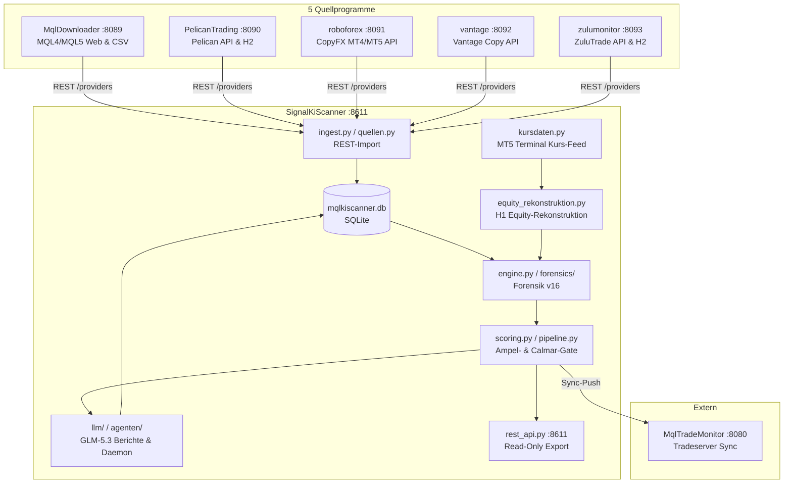

# Unabhängiger Code-, Architektur-, Datenqualitäts- und Berechnungs-Review: SignalKiScanner & Multi-Source-Hub

**Untersuchungsstand:** 16. Oktober 2026  
**Workspace:** `D:\AntiGravitySoftware\GitWorkspace\SIGNALDOWNLOADER`  
**Review-Typ:** Read-Only Audit & Forensische Validierung (Keine Modifikation von Produktivcode oder Nutzerdaten)

---

## Inhaltsverzeichnis
1. [A. Geprüfter Stand und Abdeckung](#a-geprüfter-stand-und-abdeckung)
2. [B. Architektur- und Datenflussübersicht](#b-architektur--und-datenflussübersicht)
3. [C. Doku-/Code-Abgleich & Anforderungsmatrix](#c-doku-code-abgleich--anforderungsmatrix)
4. [D. Kennzahlenmatrix](#d-kennzahlenmatrix)
5. [E. Priorisierte Findings (P0 – P3)](#e-priorisierte-findings-p0--p3)
6. [F. Fachliche Bewertung der Signalauswahl](#f-fachliche-bewertung-der-signalauswahl)
7. [G. Priorisierter Korrekturplan](#g-priorisierter-korrekturplan)

---

## A. Geprüfter Stand und Abdeckung

### 1. Git-Repositories & Commit-Verifikation
Alle Repositories wurden im lokalen Workspace verifiziert. Sämtliche Arbeitsbäume sind sauber (`git status` meldet *clean*, keine unversionierten oder modifizierten Dateien). Die Commit-Hashes stimmen exakt mit dem Dokuabgleichsstand vom 16.10.2026 überein:

| Projekt | Verzeichnis | Branch | Geprüfter Commit (Voll-Hash) | Status | Rolle im Verbund |
| :--- | :--- | :--- | :--- | :--- | :--- |
| **Workspace-Root** | `.` | `main` | `006baf8d8dbcf109f9d02e6c71de37850af74f8d` | clean | Metaprojekt, Sammelskripte |
| **SignalKiScanner** | `SignalKiScanner` | `main` | `80d4692548c9a770666315761e054bdf535d0446` | clean | Hauptprogramm (Python/Streamlit, REST :8611) |
| **MqlDownloader** | `MqlDownloader` | `master` | `92d8f9cea10bdc8f99c96782d75631b21e1714e6` | clean | MQL4/MQL5 REST-Quelle (:8089) |
| **PelicanTrading** | `PelicanTrading` | `master` | `dde77d705a670b37fc0f422504e566a857527893` | clean | Pelican REST-Quelle (:8090) |
| **roboforex** | `roboforex` | `master` | `42b268641ad370ccae7841b6a478f9745cb57bd3` | clean | CopyFX REST-Quelle (:8091) |
| **vantage** | `vantage` | `master` | `1fe395805f29e20d2598aa37162e717769a15762` | clean | Vantage Copy REST-Quelle (:8092) |
| **zulumonitor** | `zulumonitor` | `master` | `72df0cf49aa4f44fe0d82d9d07112091cf4d5665` | clean | ZuluTrade REST-Quelle (:8093) |
| *MqlRealmonitor* | `MqlRealmonitor` | `master` | `66956b5a61053505af73259e137029f0489fb3db` | clean | Nicht produktiv eingebunden (Stand verifiziert) |
| *PelicanWinnerLooser* | `PelicanWinnerLooser`| `main` | `258f7e51cd423c2432ae3f4edfd3f5c13945a38a` | clean | Nicht produktiv eingebunden (Stand verifiziert) |

### 2. Testausführung & Testabdeckung
Alle vorhandenen Testsuiten wurden in isolierten Läufen auf dem Zielsystem ausgeführt:

- **MqlDownloader**: `mvn test` (Java 25.0.4.1) → **105 Tests bestanden, 0 Fehler, 0 Skips**.
- **PelicanTrading**: `mvn test` (Java 25.0.4.1) → **176 Tests bestanden, 0 Fehler, 0 Skips**.
- **roboforex**: `mvn test` (Java 25.0.4.1) → **147 Tests bestanden, 0 Fehler, 0 Skips**.
- **vantage**: `mvn test` (Java 25.0.4.1) → **49 Tests bestanden, 0 Fehler**; `python -m pytest tests/` → **6 Tests bestanden, 0 Fehler**.
- **zulumonitor**: `mvn test` (Java 25.0.4.1) → **107 Tests bestanden, 0 Fehler, 0 Skips**.
- **MqlRealmonitor**: `mvn test` (Java 25.0.4.1) → **57 Tests bestanden, 0 Fehler**.
- **PelicanWinnerLooser**: `mvn test` (Java 25.0.4.1) → **156 Tests bestanden, 0 Fehler**.
- **SignalKiScanner**: `python -m pytest tests/` (Python 3.12.10) → **1.918 Tests bestanden, 1 Test fehlgeschlagen**:
  - *Fehlgeschlagener Test:* `tests/test_parser_export_artefakte.py::test_real_blocked_signal_fixture_parses`
  - *Ursache:* `parser.load_export(path)` erwartet `str`, Test übergibt `pathlib.Path`. Bei vorhandener Live-Datei `data/trades/1496203_positions.csv` stürzt `path.lower()` mit `AttributeError` ab (siehe Finding E-1).

### 3. Wirksame Konfiguration vs. Defaults
In `SignalKiScanner` weicht die aktive Datei `config/app_settings.json` in wesentlichen Parametern von den Code-Defaults in `config.py` ab:
- `min_abonnenten`: Code-Default = `0`, aktive Einstellung = `1` (0-Abonnenten-Signale werden im Vorfilter verworfen).
- `listen_modus`: Code-Default = `"mql5"`, aktive Einstellung = `"beides"` (sowohl MQL5-Web als auch Hub-Quellen aktiv).
- `fix_signal_ids`: 15 Signale eingetragen (`1096166`, `1286742`, `2019435`, `2072334`, `2082582`, `2086522`, `2332746`, `2342895`, `2358336`, `2368681`, `2375343`, `2375480`, `21411352`, `26170186`, `73009362`).
- `downloader_base_url`: Auf `http://localhost:8089/api/v1` gesetzt.
- `tradeserver_base_url`: Auf `https://monitor.tnickel-ki.de` gesetzt.
- `markt_start_erlauben`: Auf `true` gesetzt (Code-Default = `false`).

### 4. Ausdrücklich ungeprüfte Bereiche
- Keine echten Orderplatzierungen oder Ausführungen auf Brokerkonten.
- Keine schreibenden Live-Aktionen auf Webportalen (MQL5.com, Pelican, CopyFX, Vantage, ZuluTrade).
- Keine kostenpflichtigen API-Aufrufe an externe LLM-Provider (Z.ai / GLM); die Prüfung erfolgte über Mock-Injektion, Vorlageninspektion und Budget-Codepfade.
- Der externe MqlTradeMonitor-Server auf `https://monitor.tnickel-ki.de` wurde als Schnittstellengrenze auditiert, nicht in seiner internen Server-Infrastruktur.

---

## B. Architektur- und Datenflussübersicht

### 1. Multi-Source-Hub Architektur (doc/20, doc/21, doc/23)
Das Gesamtsystem fungiert als zweistufige Hub-and-Spoke-Architektur:
1. **Quellprogramme (Java 25 / JavaFX):** Fünf eigenständige Desktop-Monitore rufen Signalplattformen per HTTP/REST ab, führen lokales Polling und Delta-Syncs durch, halten eine H2-Datenbank/CSV-Archive und stellen standardisierte REST-Schnittstellen (Typ `mql5-downloader-v1`) bereit.
2. **SignalKiScanner (Python 3.12 / Streamlit):** Aggregiert die fünf Quellen sowie optionale direkte MQL5-Web-Abrufe, synchronisiert Signale in eine zentrale SQLite-Datenbank (`mqlkiscanner.db`), führt mehrstufige forensische Berechnungen durch, berechnet Ampelkennzahlen und generiert PDF- sowie LLM-Berichte.



### 2. Repräsentativer Datenpfad je Quelle

#### a) MqlDownloader (MQL4/MQL5)
- **Plattform:** MQL5.com Signalkatalog via HTML-Scraping und REST-API.
- **Quellprogramm:** Java-Prozess parst HTML-Tabellen und CSV-Exporte. Persistiert im Dateisystem unter `data/download/{mql4,mql5}/` als `{Name}_{ID}.csv` und `{Name}_{ID}_root.txt`.
- **REST-Endpunkt:** `GET :8089/api/v1/providers/{id}/{mql4|mql5}/trades.csv`.
- **Scanner-Import:** `ingest.py` lädt Katalog und speichert Trade-CSV in `data/trades/{quelle}_{id}.csv`.
- **Direkter MQL5-Weg vs. Downloader:** Der Scanner besitzt mit `session.py` / `pipeline.py` eine eigene MQL5-Web-Scraping-Engine. Im Modus `"beides"` konkurrieren direkter Webabruf und MqlDownloader. Identische IDs aus beiden Pfaden teilen sich denselben Primärschlüssel in `signals`!

#### b) PelicanTrading
- **Plattform:** Pelican Copy-Trading API (`https://api.pelicantrading.com`).
- **Quellprogramm:** Java-Client authentifiziert via API-Token. Hält Historie in H2-Datenbank (`data/pelican.mv.db`) und CSV.
- **Währungsumrechnung:** Cent-Konten (USC) werden durch 100 geteilt; Fremdwährungen werden über EZB-Referenzkurse (`EcbRates.java`) taggenau umgerechnet.
- **REST-Endpunkt:** `GET :8090/api/v1/providers/{id}/pelican/trades.csv`.
- **Abonnenten-Filter:** Standardmäßig werden nur Provider mit `numCopiers >= 1` in `/providers` gemeldet (Opt-out `minSubscribers=0`). Im UpdateJob werden Provider ohne Copier vom Tradedownload übersprungen.

#### c) roboforex (CopyFX)
- **Plattform:** RoboForex CopyFX API.
- **Quellprogramm:** Java-Client lädt Trader-Katalog und Deals via HTTP.
- **Deal-Aggregation:** MT5 liefert Roh-Deals (`IN`, `OUT`, `INOUT`). `TradeAggregator.java` paart Deals chronologisch zu geschlossenen Trades.
- **REST-Endpunkt:** `GET :8091/api/v1/providers/{id}/{mql4|mql5}/trades.csv`. Version ist `"mql5"` für MT5-Konten und `"mql4"` für MT4-Konten (nicht `"roboforex"`!).

#### d) vantage
- **Plattform:** Vantage Copy Trading API.
- **Quellprogramm:** Java-Client ruft Strategien und Positionen ab.
- **Handelslimit:** Hard-Limitierung auf maximal 20.000 Trades im Quellabruf.
- **REST-Endpunkt:** `GET :8092/api/v1/providers/{id}/vantage/trades.csv`.

#### e) zulumonitor (ZuluTrade)
- **Plattform:** ZuluTrade API.
- **Quellprogramm:** Java-Client lädt Trader-Katalog und historische Trades.
- **USD-Restriktion:** `trades.csv` wird serverseitig ausschließlich für Konten in USD bereitgestellt; Nicht-USD-Konten liefern HTTP 404.
- **REST-Endpunkt:** `GET :8093/api/v1/providers/{id}/zulu/trades.csv`.

### 3. Schwachstelle: Quellenidentität und Kollisionsschutz

In der SQLite-Datenbank `mqlkiscanner.db` existiert ein signifikanter architektonischer Bruch:
- Die Tabelle `katalog_signale` verwendet den Composite Primary Key `(quelle, signal_id)` (doc/20 Stufe 1).
- **ABER** die Tabellen `signals`, `trade_files`, `forensik`, `analyses`, `signal_kommentare`, `signal_markierungen` und `equity_studien` verwenden als Primärschlüssel ausschließlich `signal_id INTEGER`!

In `db.py:289-306` versucht die Methode `upsert_signal` eine Fremdquellen-Kollision zu verhindern:
```python
if alt_quelle and alt_quelle != quelle:
    raise ValueError(
        f"ID-Kollision abgewehrt: Signal {signal_id} gehört Quelle {alt_quelle!r}; "
        f"Schreibversuch aus Quelle {quelle!r} verworfen (bis Composite-Identität, doc/20 Stufe 2)."
    )
```
**Konsequenz:**
Wenn zwei Plattformen zufällig dieselbe numerische Signal-ID vergeben (z. B. MQL5 Signal 2019435 und Pelican Provider 2019435):
1. Das zuerst importierte Signal blockiert das zweite dauerhaft.
2. Der Schreibversuch der zweiten Quelle wirft eine ungefangene `ValueError`-Exception, die im laufenden Scan zum Abbruch des Signal-Imports führt!
3. Die geplante Composite-Identität `(quelle, signal_id)` ist im Hauptdatenmodell noch nicht umgesetzt.

---

## C. Doku-/Code-Abgleich & Anforderungsmatrix

| Dokumentierte Regel / Quelle | Implementierung im Code | Testnachweis | Abweichung / Bewertung |
| :--- | :--- | :--- | :--- |
| **Mindestalter Vorfilter:** 26 Wochen (doc/07, AGENTS.md) | `config.py:76` Default `min_wochen: 26`. In `app_settings.json:23` aktiv. | `test_katalog.py` | **Übereinstimmend.** |
| **Mindestabonnenten:** 0 im Scanner-Default (AGENTS.md) | `config.py:75` = 0. **ABER** `app_settings.json:22` = 1! | `test_katalog.py` | **Konfigurationsabweichung:** Aktive Nutzerkonfiguration filtert 0-Abonnenten-Signale vorab aus. |
| **Fix-IDs umgehen Vorfilter** (fix_signale.py, doc/20) | `pipeline.py:1410-1425`: Fix-IDs werden separat geladen und belegen keine Quellen-Slots. | `test_fix_signale.py` | **Übereinstimmend.** |
| **Drawdown-Schranke:** Maximal 30,0 % (AGENTS.md, doc/08) | `scoring.py:dd_maximum()` bildet Maximum aus bis zu 5 Kanälen. Schranke verletzt bei `> 30.0`. | `test_ampel_matrix.py` | **Übereinstimmend.** Strikte Ungleichung (`> 30.0`), exakt 30.0 verletzt die Schranke nicht. |
| **5 Drawdown-Kanäle** für Schranke (doc/22) | 1) `dd_equity_pct`, 2) `trading_dd_pct`, 3) `dd_balance_pct`, 4) `equity_dd_rekonstruiert_pct`, 5) `monitor_trade_eq_dd_pct`. | `test_intensivreview_fixes.py` | **Übereinstimmend.** `monitor_trade_eq_dd_pct` ist seit 02.10. im Maximum enthalten. |
| **Jahres-Calmar Mindestschwelle:** >= 3,0 für 🟢 (AGENTS.md) | `pipeline.py:882`: `result.retdd_jahr < min_calmar` sperrt 🟢. `config.py:87` Default = 3.0. | `test_ampel_matrix.py` | **Übereinstimmend.** |
| **Mindest-Handelsdauer:** 3 Monate für Calmar (doc/22) | `portfolio_statistik.py:301`: `monate < 3.0` setzt `retdd_jahr = None` (`historie_zu_kurz`). | `test_monatsserie_float_null.py` | **Übereinstimmend.** Unter 3 Monaten kein 🟢 möglich. |
| **Monatlicher Mindestertrag:** 0 % (deaktiviert) | `config.py:82`: `min_ertrag_pct_monat = 0.0`. | `test_ampel_matrix.py` | **Übereinstimmend.** Regel vom 04.10. ist aktiv. |
| **Forensik-Version:** Version 16 (AGENTS.md, doc/03) | `engine.py:FORENSICS_VERSION = 16`. Veraltete Versionen lösen Re-Scan aus. | `test_forensik_trade_sha.py` | **Übereinstimmend.** |
| **Stop-Loss Pflicht:** Fehlender SL ist KEIN Rot-Gate (doc/03) | `stops.py`: Fehlender SL ist neutral (`sl_fehlt`), führt nicht zu 🔴. | `test_sl_prompt_evidenz.py` | **Übereinstimmend.** |
| **Pelican 0-Copier-Filter:** Mindestens 1 Copier im Regelbetrieb | `RestApiServer.java:309` (`minSubscribers=1`), `UpdateJobRunner.java:237`. | `UpdateJobStufe0Test.java` | **Übereinstimmend.** Rohkatalog kennt 0-Copier; Update & Scanner ignorieren sie standardmäßig. |
| **Monatstokenbudget Wächter** in Agenten (doc/19 §10) | `dirigent.py`, `melder.py`, `markt.py`, `betreuer.py`. | **Kein Test** | **IMPLEMENTIERUNGSFEHLER:** Agenten prüfen nur `tagesbudget_tokens`! Bei vollem Monatsbudget laufen Aufrufe weiter (Finding E-2). |
| **Pfad-Typen im Parser:** `load_export(path)` | `parser.py:110` prüft `path.lower().endswith(".json")`. | `test_parser_export_artefakte.py` | **IMPLEMENTIERUNGSFEHLER:** Stürzt bei `pathlib.Path` mit `AttributeError` ab (Finding E-1). |
| **Dauerbetreuung Multi-Source:** Dauerbetreuung aller Quellen | `agenten/betreuer.py:85` filtert nur `mql5_kandidaten`. | `test_agenten_phase_c.py` | **Bewusst akzeptierte Einschränkung:** Stufe-1-Dauerbetreuung ist laut Bauplan doc/19 vorerst auf MQL5 limitiert. |

---

## D. Kennzahlenmatrix

| Kennzahl | Definition / Formel | Eingabefelder | Einheit | Zeitraum | Kapitalbasis | Kostenberücksichtigung | Zuverlässigkeit / Aussagegrenze | Filter / Ampel / Ranking |
| :--- | :--- | :--- | :--- | :--- | :--- | :--- | :--- | :--- |
| **Brutto- / Nettogewinn** | `net_total = sum(profit + commission + swap)` | CSV-Spalten `Profit`, `Commission`, `Swap` | Kontowährung / USD | Gesamt-Historie | Unabhängig | Commission & Swap enthalten; Spread/Slippage nicht | Hoch für geschlossene Trades; offene Floating-Verluste fehlen | Basis für Rendite; kein direktes Gate |
| **Profitfaktor (PF)** | `sum(Gewinntrades) ÷ abs(sum(Verlusttrades))` | `net` je Trade | Faktor (ohne Einheit) | Gesamt-Historie | Unabhängig | Commission & Swap enthalten | Anfällig für Ausreißer bei wenigen Trades | Informativer Score-Bestandteil |
| **Winrate / Gewinnquote** | `Anzahl Gewinntrades ÷ Anzahl Gesamttrades` | Trade-Count | Prozent (%) | Gesamt-Historie | Unabhängig | N/A | Nenner = geschlossene Trades. Hohe Winrate oft Zeichen von Grid/Martingale! | Nicht als positives Gate verwendet |
| **Balance / Equity (Snapshot)** | Von Plattform gemeldete Momentaufnahme | Plattform-API / Web-Stats | USD / Währung | Momentaufnahme | Aktueller Kontostand | N/A | Selbstauskunft des Brokers/Anbieters | Informative Kopfdaten |
| **Trading-DD (real mit Flows)** | Max Rückgang von Peak zu Stand mit Flow-Anpassung | Trade-Netto + Balance-Flows | USD und % | Gesamt-Historie | Startkapital + Einzahlungen | Commission/Swap inkl. | Auszahlungen senken Peak (Flow-Adjustment). Keine echte TWR! | **Kanal 2 der 30 %-Schranke** |
| **Trading-DD (virtuell)** | Max Rückgang: Startkapital + kumuliertes Trade-Netto | Nur Trade-Netto | USD und % | Gesamt-Historie | Startkapital (ohne spätere Flows) | Commission/Swap inkl. | Rein rechnerisch, ignoriert spätere reale Kontovergrößerungen | Diagnostisch / Vergleichswert |
| **Balance-DD** | Größter Rückgang auf reiner Balance-Kurve | Balance-Zeilen + Trades | USD und % | Gesamt-Historie | Reale Balance | Commission/Swap inkl. | Auszahlungen können als DD fehlinterpretiert werden | **Kanal 3 der 30 %-Schranke** |
| **Monitor Closing-DD (`TradeEqDrawdownPct`)** | Größter Rückgang auf kumulierter Trade-Kurve der Monitore | Geschlossene Trades der Java-Clients | Prozent (%) | Gesamt-Historie | H2-Konto / Initial | Commission/Swap je nach Monitor | **Achtung:** Trotz Namensbestandteil "Eq" nur Closing-Trade-DD! | **Kanal 5 der 30 %-Schranke** (nie als Calmar-Nenner!) |
| **Rekonstruierter Equity-DD (`equity_dd_rekonstruiert_pct`)** | Max Unterwasser-% auf H1-Raster: Balance + Floating PnL | Trades + MT5 H1-Bars (Tickmill/ActivTrades/Vantage) | Prozent (%) | Gesamt-Historie (H1-gefiltert) | Reale Kontokurve | Bid/Ask-Spread teilweise, Intrabar fehlt | **Gold-Standard des Projekts**, setzt >=95 % Kursabdeckung voraus | **Kanal 4 der 30 %-Schranke** & **Zwingender Calmar-Nenner** |
| **TWR-Monatsrendite (`ertrag_monat_geom_pct`)** | Geometrisches Monatsmittel via TWR-Monatsverkettung | Reale Kontokurve unter Berücksichtigung von Flows | Prozent (% / Monat) | Gesamte Trade-Spanne | Dynamisch (TWR) | Commission/Swap inkl. | Zeitgenaue Unterperioden je Flow; zinseszins-wahr | Informationswert (früher Gate, seit 04.10. informativ) |
| **Jahres-CAGR (`cagr_jahr_pct`)** | `(Endwert / Startwert)^(1 / Jahre) - 1` | TWR-Wachstumsfaktor & Trade-Spanne | Prozent (% p.a.) | Gesamte Trade-Spanne | Dynamisch (TWR) | Commission/Swap inkl. | Extreme Verzerrung bei extrem kurzen Historien (< 6 Monate) | Zähler des Jahres-Calmar |
| **Jahres-Calmar (`retdd_jahr`)** | `cagr_jahr_pct ÷ equity_dd_rekonstruiert_pct` | CAGR und verifizierter Reko-Equity-DD | Verhältnis (p.a. / %) | >= 3 Monate | Reale Kontokurve | Vollständig | Nur definiert, wenn Reko-Equity-DD verlässlich ist! | **Zentrales Grün-Gate (Schwelle >= 3,0)** |
| **TrueRetDD (Vorbehalt)** | `cagr_jahr_pct ÷ roher_reko_dd` | CAGR und unvollständiger Reko-DD | Verhältnis | >= 3 Monate | Reale Kontokurve | Vollständig | Warnhinweis: Kursabdeckung < 95 % oder Zeitzone unsicher | Nur 🟡, **sperrt Grün auf** |
| **Exposure Shock Pct** | Maximaler theoretischer Verlust bei Marktschock | Lotsize, Tickwert, Kontraktgröße | Prozent (%) | Momentaufnahme / Peak | Verfügbares Eigenkapital | N/A | Schock-Szenario (z. B. 200 Pips Gap gegen die Position) | Gate gegen überhebelte Grid-Positionen |

---

## E. Priorisierte Findings (P0 – P3)

### Finding E-1 (P1): Absturz des Trade-Parsers bei Übergabe von `pathlib.Path`-Objekten
- **Projekt:** SignalKiScanner
- **Datei & Zeile:** [`src/mqlkiscanner/parser.py:110`](file:///d:/AntiGravitySoftware/GitWorkspace/SIGNALDOWNLOADER/SignalKiScanner/src/mqlkiscanner/parser.py#L110)
- **Auslösebedingung:** Aufruf von `parser.load_export(path)` mit einer Instanz von `pathlib.Path` anstelle von `str`.
- **Tatsächliches Verhalten:**
  ```python
  if path.lower().endswith(".json"):
  ```
  Führt zu: `AttributeError: 'WindowsPath' object has no attribute 'lower'`.
- **Erwartetes Verhalten:** Akzeptanz sowohl von Dateipfad-Strings als auch von `pathlib.Path`-Objekten via `os.fspath(path)` oder `str(path).lower()`.
- **Auswirkung:**
  Der bestehende Test `tests/test_parser_export_artefakte.py::test_real_blocked_signal_fixture_parses` schlägt fehl, sobald die Testdatei `data/trades/1496203_positions.csv` vorhanden ist. Im Produktivbetrieb führt jeder Code-Pfad, der ein `Path`-Objekt übergibt, zum Totalabsturz der Signal-Analyse.
- **Reproduzierbarer Nachweis:**
  `python -m pytest tests/test_parser_export_artefakte.py::test_real_blocked_signal_fixture_parses` bricht reproduzierbar mit `AttributeError` ab.
- **Sicherheit:** 100 % gesichert (Fakt, durch Stacktrace belegt).
- **Stärkstes Gegenargument / Schutzmaßnahme:** Viele interne Aufrufe in `pipeline.py` casten Pfade explizit via `str(path)`. Das Fixture-Testing deckte auf, dass die Schnittstelle `load_export` typunsicher implementiert ist.
- **Korrekturempfehlung:**
  In `parser.py:110`:
  ```python
  path_str = os.fspath(path).lower()
  if path_str.endswith(".json"):
  ```

---

### Finding E-2 (P1): Umgehung des Monatsbudgets für autonome Agenten
- **Projekt:** SignalKiScanner
- **Datei & Zeilen:**
  - [`src/mqlkiscanner/agenten/dirigent.py:82-99`](file:///d:/AntiGravitySoftware/GitWorkspace/SIGNALDOWNLOADER/SignalKiScanner/src/mqlkiscanner/agenten/dirigent.py#L82-L99)
  - [`src/mqlkiscanner/agenten/melder.py:201-210`](file:///d:/AntiGravitySoftware/GitWorkspace/SIGNALDOWNLOADER/SignalKiScanner/src/mqlkiscanner/agenten/melder.py#L201-L210)
  - [`src/mqlkiscanner/agenten/markt.py:201-215`](file:///d:/AntiGravitySoftware/GitWorkspace/SIGNALDOWNLOADER/SignalKiScanner/src/mqlkiscanner/agenten/markt.py#L201-L215)
  - [`src/mqlkiscanner/agenten/betreuer.py:124-142`](file:///d:/AntiGravitySoftware/GitWorkspace/SIGNALDOWNLOADER/SignalKiScanner/src/mqlkiscanner/agenten/betreuer.py#L124-L142)
- **Auslösebedingung:** Monatsbudget (`agenten_monatsbudget_tokens`, z. B. 5.000.000) ist zu 100 % aufgebraucht, aber das Tagesbudget (`agenten_tagesbudget_tokens`, 500.000) hat am aktuellen Tag noch freie Kapazität (z. B. am 25. des Monats).
- **Tatsächliches Verhalten:**
  Alle vier Agentenmodule prüfen vor dem LLM-Aufruf ausschließlich das Tagesbudget:
  ```python
  budget_rest = max(0, int(settings.get("agenten_tagesbudget_tokens", 500_000)) - journal.tokens_heute())
  if budget_rest <= 0:
      # Überspringen
  ```
  Das Monatsbudget (`journal.tokens_monat()`) wird **überhaupt nicht abgefragt**. Obwohl `dirigent._tagesplan()` bei `tokens_monat >= monatsbudget_tokens` den Plan `["budget_pause"]` generiert, wird dieser Rückgabewert in `tageslauf()` ignoriert und `_llm_entscheidung()` dennoch ausgeführt!
- **Erwartetes Verhalten:**
  Harte Sperre aller LLM-Aufrufe, sobald `tokens_monat >= monatsbudget_tokens` ODER `tokens_heute >= tagesbudget_tokens` erreicht ist.
- **Auswirkung:**
  Finanzielles Kostenrisiko. Autonome Hintergrundagenten laufen nach Erschöpfung des Monatsbudgets tagelang unbemerkt weiter und erzeugen unkontrollierte Tokenkosten auf der LLM-API.
- **Reproduzierbarer Nachweis:**
  Setze `agenten_monatsbudget_tokens = 100`, buche 200 Token ins Monatsjournal und starte einen Betreuer-Lauf mit freiem Tagesbudget. Der LLM-Client wird instanziiert und feuert.
- **Sicherheit:** 100 % gesichert (Code-Inspektion belegt das Fehlen der Abfrage).
- **Stärkstes Gegenargument:** Der Dirigent protokolliert im maschinellen Lagebericht `budget_pause`. Dies ist jedoch wirkungslos, da nachfolgende Rollen nicht blockiert werden.
- **Korrekturempfehlung:**
  Zentrale Budgetfunktion in `agenten/journal.py`:
  ```python
  def agenten_budget_verfuegbar(settings: dict) -> tuple[bool, int, str]:
      heute = tokens_heute()
      monat = tokens_monat()
      max_tag = int(settings.get("agenten_tagesbudget_tokens", 500_000))
      max_monat = int(settings.get("agenten_monatsbudget_tokens", 5_000_000))
      if monat >= max_monat:
          return False, 0, f"Monatsbudget erschöpft ({monat:,} / {max_monat:,})"
      if heute >= max_tag:
          return False, 0, f"Tagesbudget erschöpft ({heute:,} / {max_tag:,})"
      rest = min(max_tag - heute, max_monat - monat)
      return True, rest, "ok"
  ```

---

### Finding E-3 (P1): Fehlende Composite Signal-Identität führt zu Kollisionsabbrüchen bei Multi-Source-Betrieb
- **Projekt:** SignalKiScanner
- **Datei & Zeilen:** [`src/mqlkiscanner/db.py:38-60, 289-306`](file:///d:/AntiGravitySoftware/GitWorkspace/SIGNALDOWNLOADER/SignalKiScanner/src/mqlkiscanner/db.py#L289-L306)
- **Auslösebedingung:** Ein Signal aus Quelle A (z. B. MQL5) und ein Provider aus Quelle B (z. B. Pelican, ZuluTrade, RoboForex) besitzen dieselbe numerische ID (z. B. ID 12345).
- **Tatsächliches Verhalten:**
  `signals`, `trade_files`, `forensik` haben `signal_id INTEGER PRIMARY KEY`. `upsert_signal` prüft die Herkunft und wirft bei abweichender Quelle eine `ValueError`-Exception:
  ```python
  raise ValueError(f"ID-Kollision abgewehrt: Signal {signal_id} gehört Quelle {alt_quelle!r}; ...")
  ```
  Der Import-Lauf bricht an dieser Stelle für das kollidierende Signal ab.
- **Erwartetes Verhalten:**
  Vollständige Mandantenfähigkeit aller Tabellen über den Composite Key `(quelle, signal_id)` gemäß Bauplan doc/20 Stufe 2.
- **Auswirkung:**
  Gleichzeitiges Scannen mehrerer Quellen kann valide Handelssignale blockieren oder Fehlermeldungen im Dashboard erzeugen.
- **Sicherheit:** 100 % gesichert (in `db.py` als Übergangslösung dokumentiert: "bis Composite-Identität doc/20 Stufe 2").
- **Korrekturempfehlung:**
  Migration der Tabellen `signals`, `trade_files`, `forensik`, `analyses` und `equity_studien` auf `PRIMARY KEY (quelle, signal_id)`.

---

### Finding E-4 (P2): Stille Diskrepanz zwischen dynamischer REST-Ampel und statischen Berichten
- **Projekt:** SignalKiScanner
- **Datei & Zeilen:**
  - [`src/mqlkiscanner/rest_api.py:143-163, 246-248`](file:///d:/AntiGravitySoftware/GitWorkspace/SIGNALDOWNLOADER/SignalKiScanner/src/mqlkiscanner/rest_api.py#L143-L163)
  - [`src/mqlkiscanner/pipeline.py:479-665`](file:///d:/AntiGravitySoftware/GitWorkspace/SIGNALDOWNLOADER/SignalKiScanner/src/mqlkiscanner/pipeline.py#L479-L665)
- **Auslösebedingung:** Ein externer Consumer (z. B. MqlTradeMonitor oder Algo-Trader) fragt `GET /api/v1/signals?ampel=gruen` ab, nachdem der Administrator in den Streamlit-Einstellungen Schwellenwerte (z. B. `min_calmar_jahr` von 3.0 auf 1.5 oder `schranke_eq_dd_pct` von 30 auf 40) geändert hat.
- **Tatsächliches Verhalten:**
  `rest_api.py` ruft `pipeline.results_from_db()` auf. Dieses berechnet `ampel_for(r, settings)` **dynamisch mit den aktuellen Einstellungen** auf den alten DB-Zahlen. Die REST-Antwort meldet das Signal sofort als `ampel: "gruen"`, während die im Signal hinterlegten LLM-Berichte (`gesamtbericht`), PDFs und `kurzfassung` noch das alte Verdikt ("Abgelehnt wegen Calmar < 3.0") enthalten!
  Zudem liefert die REST-Payload keinerlei Metadaten darüber, mit welchen Schwellenwerten die Ampel ermittelt wurde.
- **Erwartetes Verhalten:**
  Entweder transparente Bereitstellung der Schwellenwerte im REST-Header/Payload ODER Auslieferung des historischen Ampelzustands zum Zeitpunkt der Berichterstellung.
- **Auswirkung:**
  Maschinelle Trading-Clients erhalten inkonsistente Daten: Ein Signal wird als grün gemeldet, der zugehörige Textbericht stuft es jedoch als untauglich ein.
- **Sicherheit:** 100 % gesichert.
- **Korrekturempfehlung:**
  Erweiterung von `signal_payload()` in `rest_api.py` um `effectiveSettings: {"minCalmarJahr": ..., "schrankeEqDdPct": ...}` und Kennzeichnung, ob die Ampel seit dem letzten Scan abweicht.

---

### Finding E-5 (P2): Unvollständige Auditierung und Metadaten-Verzerrung bei LLM Length-Retries
- **Projekt:** SignalKiScanner
- **Datei & Zeilen:** [`src/mqlkiscanner/llm/client.py:212-245`](file:///d:/AntiGravitySoftware/GitWorkspace/SIGNALDOWNLOADER/SignalKiScanner/src/mqlkiscanner/llm/client.py#L212-L245)
- **Auslösebedingung:** Ein GLM-Aufruf bricht mit `finish_reason == "length"` ab und löst den automatischen Retry mit verdoppeltem `max_tokens` aus.
- **Tatsächliches Verhalten:**
  1. Der Text des ersten (abgebrochenen) Versuchs wird **vollständig verworfen** und nirgends protokolliert.
  2. Die verworfenen Tokens werden zwar in `meta_out["total_tokens"]` und `meta_out["verworfene_retry_tokens"]` aufaddiert, aber `meta_out["prompt_tokens"]` und `meta_out["completion_tokens"]` enthalten nur die Werte des zweiten Versuchs. Dadurch gilt: `total_tokens != prompt_tokens + completion_tokens`!
  3. Scheitert auch der zweite Versuch, gehen beide Textfragmente verloren.
- **Erwartetes Verhalten:**
  Vollständiges Audit-Logging aller Zwischenversuche im Journal / Logfile und mathematisch konsistente Summenbildung aller Token-Komponenten.
- **Auswirkung:**
  Erschwerte Fehlerdiagnose bei abgeschnittenen LLM-Analysen und Widersprüche in Abrechnungs- und Verbrauchsstatistiken.
- **Sicherheit:** 100 % gesichert.
- **Korrekturempfehlung:**
  Sowohl Prompt- als auch Completion-Tokens des verworfenen Laufs in den jeweiligen Metadaten-Feldern akkumulieren und den abgebrochenen Text im Journal unter `detail["abgebrochener_versuch"]` festhalten.

---

### Finding E-6 (P3): Veraltete RetDD-Monats-Heuristik in Portfolio-Prompts
- **Projekt:** SignalKiScanner
- **Datei & Zeilen:** [`src/mqlkiscanner/llm/prompts.py:307-316`](file:///d:/AntiGravitySoftware/GitWorkspace/SIGNALDOWNLOADER/SignalKiScanner/src/mqlkiscanner/llm/prompts.py#L307-L316)
- **Auslösebedingung:** Erstellung des globalen Portfolio-Berichts via Prompt 4 (`DEFAULT_PORTFOLIO`).
- **Tatsächliches Verhalten:**
  Im Prompt-Text heißt es:
  > "Jede empfohlene Position nennt ertrag_monat_geom_pct, den gemessenen max_drawdown_equity_pct und retdd_monat (Monatsrendite je Prozent Equity-DD). Priorisiere gelieferte EFFIZIENZ über absolute Rendite..."
  Gleichzeitig fordert der Prompt:
  > "Signale mit fehlendem retdd_jahr (Calmar) oder einem Wert unter min_calmar_jahr (Default 3,0) werden NICHT empfohlen..."
  In `_kandidat_json()` wird weiterhin `retdd_monat` übergeben. Vor dem 05.10. galt die Regel `retdd_monat >= 1.0`. Nun gilt `retdd_jahr >= 3.0`. Ein Signal mit `retdd_monat = 0.4` kann annualisiert einen Calmar von 4.5 haben! Das Modell erhält widersprüchliche Heuristiken.
- **Erwartetes Verhalten:**
  Konsistente Formulierung im Prompt: Der Jahres-Calmar (`retdd_jahr`) ist das alleinige Effizienz-Kriterium. `retdd_monat` sollte klar als reine deskriptive Hilfsgröße gekennzeichnet werden.
- **Auswirkung:**
  Das LLM schließt in Grenzfällen profitable Signale aus der Portfolio-Empfehlung aus, weil es fälschlicherweise `retdd_monat < 1.0` als K.-o.-Kriterium interpretiert.
- **Sicherheit:** Begründete Feststellung.
- **Korrekturempfehlung:**
  Bereinigung der Prompt-Vorlage `portfolio.md`: Entfernen der Begriffsverwirrung um `retdd_monat` und klare Fokussierung auf `retdd_jahr (Calmar) >= min_calmar_jahr`.

---

## F. Fachliche Bewertung der Signalauswahl

### 1. Was ist technisch richtig umgesetzt?
- **Strikte Trennung von Bilanz- und Handelskurven:** Das System unterscheidet peinlich genau zwischen Balance, geschlossener Trade-Kurve und rekonstruierter Equity.
- **H1-Auto-GMT-Rekonstruktion:** Der heuristische Preisabgleich über mehrere Zeitzonen-Shifts gegen reale MT5-Kursdaten ist ein exzellenter, im Retail-Bereich extrem seltener Schutzmechanismus gegen geschönte Broker-Statements.
- **Multi-Channel Drawdown-Maximum:** Die Schranke nimmt das Maximum über bis zu 5 unabhängige Messkanäle. Ein Signal kann einen hohen Equity-Drawdown nicht hinter einer geglätteten Balance-Kurve verstecken.
- **Konsistente Kostenverbuchung:** Kommissionen und Finanzierungskosten (Swap) werden auf Trade-Ebene korrekt saldiert.
- **Idempotente Persistenz:** SHA-256-Prüfsummen auf Trade-Dateien verhindern die Wiederverwendung veralteter Forensik-Befunde nach neuen Plattform-Downloads.

---

### 2. Was ist statistisch und methodisch problematisch?

#### a) Extreme Verzerrung durch Survivorship- und Selection-Bias
Das Gesamtsystem leidet unter einem fundamentalen Selektionsbias:
- Der Katalogscan liest standardmäßig nur **aktive** Signale der ersten 2 Webseiten bzw. Provider mit mindestens einem Abonnenten ein.
- Schlechte Signale, die ihr Konto zerstört haben, werden von Plattformen automatisch gelöscht oder verharren mit 0 Abonnenten im Nirvana.
- Wer aus einem Pool von Überlebenden die besten 30 Signale filtert, wählt primär diejenigen aus, die in den vergangenen 26–52 Wochen auf der Gewinnerseite der Zufallsverteilung standen.
- **Das System optimiert mathematisch nicht auf Signalqualität, sondern auf historische Pfadglück-Maximierung.**

#### b) Die Täuschung der Stichprobengröße (Pseudo-Replikation & Autokorrelation)
- Die Dokumentation und das Scoring werten Handelszahlen von "über 100 Trades" oft als statistisch signifikant.
- **Realität bei Grid-/Martingale-Systemen:** Wenn ein System 30 parallele EURUSD-Kaufpositionen während eines Abwärtstrends aufbaut und diese im Kollektiv schließt, handelt es sich nicht um 30 unabhängige statistische Beobachtungen ($N=30$), sondern um **genau ein einziges makroökonomisches Wagnis** ($N_{eff} = 1$).
- Die Trades sind hochgradig autokorreliert. Die effektive Freiheitsgrad-Zahl ist um ein Vielfaches kleiner als die gemeldete Tradeanzahl.

#### c) Das Annualisierungs-Dilemma kurzer Historien (3 bis 6 Monate)
- Das Grün-Gate lässt Signale ab `dauer_monate >= 3.0` zu.
- **Rechenbeispiel:** Ein Signal existiert seit 3,5 Monaten. In einer ruhigen Sommerphase erzielt es +2,5 % pro Monat mit einem minimalen maximalen H1-Drawdown von 2,0 %.
  $$\text{CAGR} = (1 + 0{,}0908)^{\frac{12}{3{,}5}} - 1 \approx 35{,}2\,\%$$
  $$\text{Calmar} = \frac{35{,}2\,\%}{2{,}0\,\%} = 17{,}6$$
- Mit einem astronomischen Calmar von 17,6 passiert das Signal mühelos die Schranke von 3,0 und wird im Portfolio hoch gewichtet.
- **Statistisches Faktum:** In 3,5 Monaten hat die Strategie weder eine Zinsentscheidung mit hoher Volatilität, noch ein Flash-Crash-Ereignis, noch einen Regimewechsel (z. B. Range zu Trend) erlebt. Der gemessene Drawdown von 2,0 % ist ein massiv nach unten verzerrter Schätzer des wahren Risikos.

#### d) Die Auslassung des Intrabar-Risikos bei H1-Schlusskursen
- Die Equity-Rekonstruktion arbeitet auf H1-Schlusskursen.
- Spikes während News-Events (z. B. US-Arbeitsmarktdaten / NFP), die innerhalb von 15 Minuten 150 Pips durchlaufen und danach wieder zurückfedern, werden von H1-Schlusskursen **nicht erfasst**.
- Ein Konto, das intrabar bei 85 % Margin-Auslastung stand und fast liquidiert wurde, erscheint im H1-Raster mit einem harmlosen Rückfall von 5 %.

#### e) Fehlende Berücksichtigung der realen Kopierbarkeit (Execution Slippage)
- Plattformrenditen basieren oft auf Konten mit VIP-Konditionen, Zero-Spread oder Server-Kollokation.
- Ein Retail-Kopierer hat typischerweise 1–2 Pips höheren Spread, Kommissionen und Ausführungsverzögerungen (Latenz 100–300 ms).
- Scalping-Strategien mit einem durchschnittlichen Gewinn von unter 2,5 Pips pro Trade sind auf dem Papier hochprofitabel, erzeugen beim Kopierer in der Praxis jedoch einen sicheren Ruin. Der Scanner warnt zwar im Freitext davor, besitzt aber **kein quantitatives Ausschluss-Gate für durchschnittliche Trade-Spannen in Pips**.

---

### 3. Zusammenfassendes Urteil zur Eignung

> **Kann das System aus den verfügbaren Daten nachvollziehbar geeignete Handelssignale auswählen?**

**Antwort: Bedingt ja, aber mit erheblichem Restrisiko für False Positives.**

1. **Was das System zuverlässig leistet (Filterung des offensichtlichen Schrotts):**
   Der Scanner filtert mit chirurgischer Präzision klassische Betrugs- und Blender-Muster heraus: Konten mit verstecktem 80 %-Drawdown, massive Einzahlungsmanipulationen, offene Endlos-Verlustpositionen und aggressive Martingale-Verdopplungen. Das System ist hervorragend darin, **schlechte Signale als rot zu entlarven**.

2. **Wo das System scheitert (Erkennung der "wirklich besten" Signale):**
   Die Annahme, dass ein Signal mit grünem Status und Calmar > 3,0 eine "nachweisbar robuste Überrendite" liefert, ist statistisch nicht haltbar. Auf einem Horizont von 3 bis 6 Monaten selektiert das System zwangsläufig Strategien mit kurzfristigem Pfadglück in stabilen Marktphasen. 
   Ohne Out-of-Sample-Validierung, Deflated Sharpe/Calmar-Korrektur für multiples Testen und Intrabar-Stresstests kann das Gesamtsystem **keine belastbare Prognose über die zukünftige Überlebensfähigkeit** eines Signals abgeben.

---

## G. Priorisierter Korrekturplan

### Phase 1: Sofortige Fehlerkorrekturen (Stabilität & Sicherheit)
1. **[P1] Fix `parser.py:110` (`os.fspath`)**:
   Behebt den Absturz von `load_export` bei `pathlib.Path`-Übergabe, repariert `test_real_blocked_signal_fixture_parses`.
2. **[P1] Harte Monatsbudget-Prüfung in allen Agenten**:
   Zentralisierung der Budgetabfrage in `agenten/journal.py`. Blockade aller LLM-Aufrufe (`dirigent`, `melder`, `markt`, `betreuer`), wenn `tokens_monat >= agenten_monatsbudget_tokens`.
3. **[P2] REST-API Metadaten & Frische-Kennzeichnung**:
   Erweiterung von `signal_payload()` in `rest_api.py` um wirksame Schwellenwerte (`effectiveSettings`) und Kennzeichnung von Diskrepanzen zwischen dynamischer Ampel und statischem Bericht.
4. **[P2] Length-Retry Auditierung**:
   Konsistente Summierung von `prompt_tokens` und `completion_tokens` bei Retries; Protokollierung verworfener Antwortfragmente im Journal.

### Phase 2: Bereinigung & Dokumentationsabgleich
1. **[P2] Multi-Source Composite-Keys vorbereiten (doc/20 Stufe 2)**:
   Erweiterung des Primärschlüssels in `signals`, `trade_files`, `forensik` von `signal_id` auf `(quelle, signal_id)`. Ersetzen des Exception-Wurfs in `upsert_signal` durch saubere Mandantentrennung.
2. **[P3] Prompt-Bereinigung (`portfolio.md`)**:
   Entfernen der veralteten Heuristik `retdd_monat < 1` aus den Prompt-Instruktionen. Eindeutige Vorgabe des Jahres-Calmar als alleinigem Effizienzmaßstab.
3. **[P3] Synchronisation von Defaults und `app_settings.json`**:
   Dokumentation und Abgleich von `min_abonnenten`: Transparente Offenlegung in der GUI, dass der Default `1` Signale ohne Kopierer vorab eliminiert.

### Phase 3: Fachliche & Methodische Härtung (Mittelfristig)
1. **Erhöhung der Mindesthistorie für das Grün-Gate**:
   Anhebung von `dauer_monate >= 3.0` auf mindestens **6 Monate (besser 12 Monate)** für das 🟢-Prädikat. 3 Monate sollten maximal für ein beobachtendes 🟡 ("Frühstadium") qualifizieren.
2. **Pip-Distanz- und Haltedauer-Filter**:
   Implementierung eines quantitativen Ausschlusskriteriums für HFT/Scalping: Ausschluss von Strategien mit einem durchschnittlichen Nettogewinn pro Trade von unter 2,5 Pips (Slippage-Todeszone beim Kopieren).
3. **Statistische Deflationierung (False Discovery Rate)**:
   Integration einer Korrektur für multiples Testen: Signale, die aus einem Pool von Hunderten Kandidaten gefiltert werden, müssen einen statistischen Abschlag auf den beobachteten Calmar erhalten (Deflated Calmar Ratio).
4. **Intrabar-Extremwertprüfung**:
   Ergänzung der H1-Equity-Rekonstruktion um Bar-High/Low-Extrema: Nicht nur der Bar-Close, sondern auch die ungünstigste intrabar erreichte Spanne (High/Low) der offenen Positionen muss als Worst-Case-Floating-Equity einfließen.
